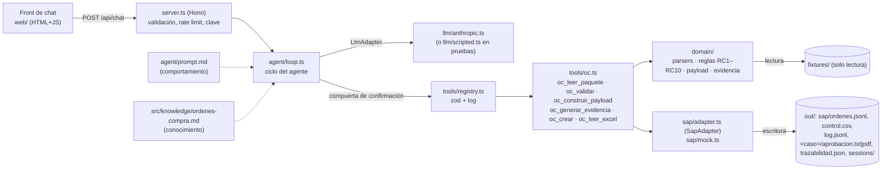

# SOLUCIÓN — Reto 03 · Agente conversacional "Órdenes de Compra SAP"

## 1. Problema en una frase

La analista administrativa digita a mano en SAP cada orden de compra a partir de un Excel, una cotización y un correo de aprobación, y valida de memoria que el aprobador pueda aprobar ese monto en ese centro; el agente lee el paquete, lo valida contra los maestros, arma la OC con trazabilidad y la crea en SAP, devolviendo al humano solo las excepciones.

A quién le duele:

| Actor | Dolor |
|---|---|
| Analista administrativa | Digitación repetitiva y errores que se corrigen en el cierre (un centro de costo mal digitado). |
| Contabilidad / auditoría | El control "quien aprueba puede aprobar" no es sistemático y la evidencia es un PDF impreso a mano. |
| Dirección | Nadie mide cuántas OC son retroactivas (se crean después de la factura y se salta la cotización). |

## 2. Arquitectura

| Separación | Dónde vive | Qué cambia ahí |
|---|---|---|
| **Comportamiento** | `agent/prompt.md` | Rol, reglas no negociables, flujo y formato de respuesta. |
| **Conocimiento** | `src/knowledge/ordenes-compra.md` | Proceso, significado de reglas y códigos, qué pedir ante cada bloqueo. |
| **Ejecución** | `src/tools/` (contrato) y `src/domain/` (reglas puras) | Lectura, validación, cálculo, creación. Umbrales como constantes nombradas (`TOLERANCIA_COTIZACION`, `TOLERANCIA_ARITMETICA`). |

El servidor (`server.ts`) y el ciclo (`agent/loop.ts`) no contienen reglas de negocio: cambiar el umbral del 2 % o una regla solo toca `src/domain/reglas.ts`. El prompt y el conocimiento se leen en cada turno (`prompt-loader.ts`), no se embeben en el código.

## 3. Ciclo del agente

`Agente.turno(sessionId, mensaje)` en `src/agent/loop.ts`:

1. Valida el mensaje (no vacío, ≤ 4.000 caracteres) y carga o crea la sesión (`session.ts`: memoria + `out/sessions/<id>.json`).
2. **Clasifica el mensaje** frente a lo pendiente del turno anterior (`confirmacion.ts`) y arma la **compuerta** del turno.
3. Bucle de hasta `AGENT_MAX_ITERATIONS` (25): envía system prompt + historial + definiciones de herramientas al `LlmAdapter`; si el modelo pide herramientas, el registry las valida con zod, aplica la compuerta, las ejecuta **en secuencia**, registra cada llamada en `out/log.jsonl` y devuelve los resultados (con `is_error`) al modelo. Si no pide herramientas, su texto es la respuesta.
4. **Tope de iteraciones (CA1)**: si se agota, la respuesta es determinista: "Alcancé el límite de pasos. Hecho: … Pendiente: …", construida desde las llamadas del turno.
5. **Tope de tokens por sesión** (`SESSION_MAX_TOKENS`): antes de cada llamada; al alcanzarlo se responde que la sesión llegó a su tope.
6. **Errores (CA5)**: el adaptador traduce timeout (`LLM_TIMEOUT_MS`), 401, 429, 5xx y caídas de conexión a `ErrorLlm` con mensaje legible; el SDK reintenta 2 veces con backoff exponencial ante 408/409/429/5xx. El ciclo muestra el error en el chat y la sesión sigue viva. Las herramientas nunca lanzan (`safeTool`): devuelven `{ ok: false, error }` que el modelo explica.
7. **Grounding (CA2)**: antes de responder, `grounding.ts` extrae los números de ≥ 4 dígitos del texto del modelo y verifica que aparezcan en algún resultado de herramienta (o en lo que escribió el usuario). Si alguno no aparece, agrega "⚠️ Verifica: el valor X no proviene de una herramienta." y lo registra en el log.
8. Calcula `needsConfirmation` y `pendiente`, persiste la sesión y devuelve `{ sessionId, reply, toolCalls, needsConfirmation, pendiente }`.

**Confirmación humana impuesta en el servidor (CA3).** No se confía solo en el prompt:

- Al cerrar cada turno, un caso queda *pendiente* si `oc_validar` lo dio apto con confirmaciones (o el usuario pidió "no la crees") y no hubo `oc_crear` exitoso, o si `oc_crear` respondió "requiere confirmación". Si el siguiente mensaje no confirma ni cancela (p. ej. una pregunta), lo pendiente se conserva.
- El clasificador determinista marca el mensaje como `afirmativo` ("sí", "confirmo", "procede", "dale", "créala"…), `negativo` ("no", "cancela", "espera", "todavía no") u `otro`. La negación gana.
- La compuerta del registry solo deja pasar `oc_crear` con `confirmado=true` si el mensaje de **este** turno es afirmativo y el caso estaba pendiente en el turno anterior. Con varios pendientes, el usuario debe nombrar el caso (`sol-004`) o decir "todos"; si no, la herramienta responde "Hay varias OC pendientes; pregunta cuál confirmar".
- Si el usuario pidió "no la crees (hasta que confirme)", la compuerta rechaza cualquier `oc_crear` con payload en ese turno.
- Un intento del modelo de autoconfirmarse devuelve "requiere confirmación explícita del usuario en su último mensaje" y queda en el log. Hay pruebas para cada camino (`tests/agent/loop.test.ts`).

**Historial y costo.** El historial se envía completo (con los bloques originales del modelo, incluidos los de razonamiento, sin modificarlos). No se recortan resultados antiguos: editar turnos previos invalida la caché de prompts y, en Claude Opus 5.5, los bloques de razonamiento ligados a la conversación. El control de costo lo hacen el tope de tokens por sesión, el tope de iteraciones y la caché de prompts (system + herramientas + historial).

## 4. Elección del modelo

| Aspecto | Decisión |
|---|---|
| Proveedor | Anthropic (Messages API, `@anthropic-ai/sdk`), detrás del adaptador propio `LlmAdapter`. |
| Modelo | `claude-opus-5-5` por defecto (configurable con `LLM_MODEL`), esfuerzo `medium` (`LLM_EFFORT`). |
| Por qué | Uso de herramientas fiable en flujos de varios pasos, buen español, sigue formatos (tablas) y reglas de "no afirmar sin herramienta". El esfuerzo `medium` equilibra calidad y tokens para un flujo guiado por herramientas. |
| Fallback | Se activa el *fallback* del servidor (`fallbacks: "default"`, beta `server-side-fallback-2026-07-01`): si el modelo declina por política, la API reintenta con el modelo de respaldo definido por Anthropic; si aun así declina (`stop_reason: refusal`), el chat muestra un mensaje claro. |
| Caché | `cache_control` en el system prompt, en la última herramienta y automático sobre el historial: en cada iteración del ciclo se relee el prefijo desde caché (0,05× del precio de entrada en Opus 5.5). |
| Intercambiable | `ScriptedLLM` implementa la misma interfaz y corre todas las pruebas del ciclo sin clave; otro proveedor es una clase nueva más `LLM_PROVIDER`. |

**Costo estimado por caso.** Precios de `claude-opus-5-5` ([platform.claude.com/docs/en/about-claude/pricing](https://platform.claude.com/docs/en/about-claude/pricing)): entrada USD 4 / MTok, salida USD 20 / MTok, lectura de caché USD 0,20 / MTok, escritura de caché (5 min) USD 5 / MTok. El system prompt + definiciones de herramientas ocupan ≈ 6–7 mil tokens y un caso típico usa 4–6 llamadas al modelo (leer → validar → evidencia + payload → crear → respuesta).

| Escenario medido con `bun run smoke:llm` | Llamadas | Entrada | Caché lectura | Caché escritura | Salida | USD |
|---|---|---|---|---|---|---|
| Se completa al ejecutar la prueba con modelo real | — | — | — | — | — | — |

Alternativa más barata: `claude-sonnet-5-5` (USD 2 / 10 por MTok) o `claude-haiku-5-5` (USD 0,10 / 0,50) cambiando `LLM_MODEL`; como las reglas y los cálculos están en código, el modelo solo orquesta y redacta, lo que hace viable un modelo pequeño. Lo decidiría midiendo el mismo `smoke:llm` con cada modelo.

## 5. Matriz de controles

Cada regla es una función pura `(paquete, maestros) → ResultadoRegla` en `src/domain/reglas.ts`; `validarPaquete` las ejecuta **todas** (no se detiene en el primer bloqueo) y agrega bloqueos, confirmaciones, derivados, `retroactiva` y `reglas_evaluadas`.

| Regla | Función | Tipo | Implementación | Pruebas |
|---|---|---|---|---|
| RC1 | `rc1` | Bloqueo | Busca por NIT de la solicitud, luego de la cotización (normalizado sin puntos ni DV), y si no hay NIT por nombre normalizado (sin tildes ni sufijo societario). Informa `resuelto_por`. Inexistente o inactivo → bloqueo. | `reglas.test.ts` (4), golden sol-002 |
| RC2 | `rc2` | Bloqueo | Aprobación ausente, sin "Aprobado" (con detección de negación), centro inexistente o remitente fuera de `aprobadores` del centro. Si aprueba en otro centro lo dice, lista los aprobadores válidos y, si el correo menciona una subárea del otro centro, sugiere revisar el centro. | `reglas.test.ts` (5), golden sol-003 |
| RC3 | `rc3` | Bloqueo | Aprobador válido: `valor_total ≤ tope`. Aprobador inválido: contra el mayor tope del centro ("ningún aprobador de CC-2020 tiene tope ≥ 74.000.000"). | `reglas.test.ts` (3), golden sol-003 |
| RC4 | `rc4` | Bloqueo | Subárea normalizada ∈ subáreas del centro; lista las válidas. | `reglas.test.ts` (2) |
| RC5 | `rc5` | Confirmación | Sin cotización → confirmación. Diferencia relativa > `TOLERANCIA_COTIZACION` (2 %) → confirmación con ambos valores y el %; agrega el monto que menciona la aprobación ("25 millones"). | `reglas.test.ts` (3), golden sol-004 |
| RC6 | `rc6` | Confirmación + derivado | IVA ausente → `indicador_iva_default` del proveedor como derivado + confirmación; informado e inexistente → bloqueo. | `reglas.test.ts` (3), golden sol-006 |
| RC7 | `rc7` | Derivado | Condiciones ausentes → `condiciones_pago_default` (solo se informa); código inexistente → bloqueo. | `reglas.test.ts` (3), golden sol-006 |
| RC8 | `rc8` | Confirmación | `factura.fecha < fecha_solicitud` → `retroactiva = true` + confirmación. | `reglas.test.ts` (3), golden sol-005 |
| RC9 | `rc9` | Confirmación | Fecha local (−05:00) de la aprobación ≥ fecha de solicitud, comparando `YYYY-MM-DD` sin `new Date()`. | `reglas.test.ts` (2) |
| RC10 | `rc10` | Bloqueo | `abs(cantidad × valor_unitario − valor_total) ≤ TOLERANCIA_ARITMETICA` (1). | `reglas.test.ts` (2) |

**La más difícil: RC2/RC3 en sol-003.** No basta con decir "el aprobador no es válido": fvargas sí es aprobador (de CC-3030, tope 80 M) y el monto (74 M) estaría dentro de su tope, pero la solicitud está imputada a CC-2020, donde el tope máximo es 30 M. Hubo que decidir contra qué tope evaluar RC3 cuando el aprobador no pertenece al centro (el mayor del centro, para que el bloqueo diga si existe alguien que pudiera aprobar) y redactar una acción útil: el correo dice "equipo de preventa", subárea de CC-3030, así que la acción sugiere verificar si el centro correcto es CC-3030 en vez de pedir otra aprobación a ciegas. El matiz de sol-004 (la aprobación dice "25 millones" y la cotización es 26,5 M) se resolvió informando el monto aprobado dentro del detalle de RC5 y creando la OC por el valor de la solicitud.

## 6. Diseño del adaptador SAP real

**Opción recomendada.** Implementar `SapAdapter` contra SAP sin tocar herramientas ni agente (la factoría `getSapAdapter` permite sustituir el mock):

| Si el cliente tiene… | Integración | Por qué |
|---|---|---|
| S/4HANA (on-premise o cloud) | OData V2 `API_PURCHASEORDER_PROCESS_SRV` (servicio estándar publicado) | Documentado, soporta creación profunda (cabecera + posiciones + imputación) y `$batch` con *changesets* atómicos. |
| ECC | RFC/BAPI `BAPI_PO_CREATE1` + `BAPI_TRANSACTION_COMMIT` vía SAP Cloud Connector o middleware existente | Es la BAPI estándar de creación de pedidos; transaccional con commit/rollback explícito. |
| SAP Integration Suite ya operativo | iFlow que expone un endpoint propio y llama a OData/BAPI | Centraliza credenciales, monitoreo y reintentos. |

Como la viabilidad no está confirmada, el diseño se apoya en la interfaz: primero el Plan B (abajo), luego la implementación real cuando TI habilite el canal.

**Mapeo (OData `A_PurchaseOrder` / BAPI).** Nombres según la especificación pública del servicio; se deben confirmar contra la versión del cliente en SAP Business Accelerator Hub antes de implementar.

| Payload (§7.4) | OData `API_PURCHASEORDER_PROCESS_SRV` | `BAPI_PO_CREATE1` |
|---|---|---|
| `sociedad` | `CompanyCode` | `POHEADER-COMP_CODE` |
| `organizacion_compras` | `PurchasingOrganization` | `POHEADER-PURCH_ORG` |
| `proveedor.codigo_sap` | `Supplier` | `POHEADER-VENDOR` |
| `moneda` | `DocumentCurrency` | `POHEADER-CURRENCY` |
| `condiciones_pago` | `PaymentTerms` | `POHEADER-PMNTTRMS` |
| `referencia.solicitud_id` | campo de referencia de cabecera (p. ej. `CorrespncExternalReference`) | campo de referencia de cabecera (`POHEADER-OUR_REF` / "su referencia", según configuración) |
| `posiciones[].numero` | `to_PurchaseOrderItem/PurchaseOrderItem` | `POITEM-PO_ITEM` |
| `posiciones[].descripcion` | `PurchaseOrderItemText` | `POITEM-SHORT_TEXT` |
| `posiciones[].cantidad` / `unidad` | `OrderQuantity` / `PurchaseOrderQuantityUnit` | `POITEM-QUANTITY` / `POITEM-PO_UNIT` |
| `posiciones[].precio_unitario` | `NetPriceAmount` (convertido a neto con la tasa del indicador) | `POITEM-NET_PRICE` |
| `posiciones[].indicador_iva` | `TaxCode` | `POITEM-TAX_CODE` |
| `posiciones[].centro_costo` | `AccountAssignmentCategory = "K"` + `to_AccountAssignment/CostCenter` | `POITEM-ACCTASSCAT = "K"` + `POACCOUNT-COSTCENTER` |
| `posiciones[].subarea` | texto o campo de imputación según configuración (orden interna / elemento PEP / texto) | `POTEXTITEM` o campo de imputación |
| `aprobador` + evidencia | texto de cabecera + anexo (GOS / Attachment Service) con el PDF y su SHA-256 | `POTEXTHEADER` + anexo GOS |

Campos que el payload no trae y habría que parametrizar por configuración: clase de documento (`PurchaseOrderType` / `DOC_TYPE`, p. ej. NB), grupo de compras (`PurchasingGroup`), centro/planta (`Plant`), grupo de artículos (`MaterialGroup`) y cuenta de mayor (`GLAccount`) para imputación a centro de costo. Además se marcarían las estructuras `...X` de la BAPI.

**Autenticación y credenciales.** Usuario técnico con permisos mínimos (crear pedidos de la sociedad 1000, sin aprobación de liberación) u OAuth 2.0 *client credentials* mediante una BTP Destination. Los secretos viven en un gestor (Azure Key Vault / AWS Secrets Manager / BTP Credential Store) y se inyectan al servicio de integración; nunca en el agente, el prompt, el repositorio ni los logs. El modelo nunca ve credenciales: solo llama `oc_crear`, que llama al adaptador.

**Idempotencia ante reintentos.** `buscarOrdenPorReferencia(solicitud_id)` antes de crear, usando el campo de referencia de cabecera; además una tabla de control propia (`solicitud_id → numero_oc, estado`) con estado "en curso" antes de llamar a SAP, para cubrir el caso "SAP creó pero la respuesta se perdió": ante un timeout se consulta por referencia antes de reintentar. Reintentos con backoff solo ante errores transitorios (timeouts, 503, bloqueos de objeto).

**Error parcial.** En BAPI se revisa la tabla `RETURN`: cualquier mensaje tipo E/A → `BAPI_TRANSACTION_ROLLBACK`, si no `BAPI_TRANSACTION_COMMIT` con `WAIT = 'X'`. En OData se usa `$batch` con un *changeset* (todo o nada). En ambos casos se registra `resultado=error_sap` en `control.csv` con el mensaje de SAP y el caso queda para revisión humana; el agente explica el error en el chat.

**Plan B si no hay conexión.** El agente sigue ahorrando la validación, la evidencia y el armado: (a) entrega la OC "lista para pegar", campo por campo en el orden de la transacción ME21N (cabecera, posición, imputación), con la evidencia PDF para adjuntar; (b) genera un archivo de carga masiva (CSV/Excel) con el layout que defina el equipo SAP (LSMW, programa Z o *Migration Cockpit*) para cargar lotes al final del día. El `control.csv` sigue midiendo retroactivas aunque la creación sea manual.

## 7. Lectura del proceso

*Para la dirección.* El agente registra cada intento en `out/control.csv` con la columna `retroactiva`. En los fixtures, 1 de 4 OC creadas (25 %) fue retroactiva: la papelería de sol-005, facturada el 10 de agosto y solicitada el 27; la aprobación lo dice explícitamente ("Ya llegó la factura, por favor crear la OC para poder radicarla"). Una OC retroactiva significa que el gasto se comprometió sin control previo: nadie validó el aprobador ni el tope antes de comprar, la cotización se pidió (o se fechó) después y la OC solo sirve para radicar la factura.

Lo que propondría:

1. **Medir antes de decidir**: un reporte mensual por centro de costo, aprobador y proveedor con el % de OC retroactivas y su monto (sale directo de `control.csv`).
2. **Política "sin OC no hay pago"** con excepciones documentadas: la factura sin OC previa se radica solo con una justificación del aprobador y queda marcada.
3. **OC abiertas o contratos marco** para gastos recurrentes de bajo monto (papelería, tóner, cafetería): se consumen contra un cupo y eliminan la mayoría de retroactivas legítimas.
4. **Umbral por monto**: por debajo de cierto valor, aprobación simplificada; por encima, la OC previa es obligatoria.
5. **Comunicar el proceso a proveedores**: que no facturen sin número de OC.

La decisión de tolerar con marca o rechazar es de la dirección; el agente ya mide y no bloquea.

## 8. Decisiones y trade-offs

| # | Decisión | Alternativa descartada | Por qué |
|---|---|---|---|
| 1 | **Reglas deterministas en código** (`domain/reglas.ts`), el LLM solo orquesta y redacta. | Darle las reglas al modelo en el prompt. | Las reglas son de control contable: deben ser reproducibles, probadas y auditables. El modelo puede equivocarse en una comparación de fechas o un porcentaje; una función pura con pruebas no. |
| 2 | **Las herramientas recalculan desde el caso** y comparan lo que recibe el modelo (`paquete`, `derivados`, `payload`); si difiere, rechazan con el campo exacto. | Confiar en los argumentos del modelo. | Mitiga "el modelo arregla un monto para que cuadre". El costo es redundancia de cómputo (milisegundos) y que el modelo debe reenviar lo que recibió; los textos libres (`texto`) se pueden omitir para ahorrar tokens. |
| 3 | **Compuerta de confirmación en el servidor** + clasificador determinista. | Solo pedirlo en el prompt. | CA3 dice "solo procede si el siguiente mensaje confirma": eso es una regla de seguridad, no de estilo. Con la compuerta, un modelo que se autoconfirma no crea nada. El costo es que frases muy ambiguas ("sí, pero no la de sol-006") se tratan como negativas: preferible a crear de más. |
| 4 | **Front sin build** (HTML + JS + `marked`/`DOMPurify` desde CDN). | React/Vite. | Un solo comando levanta todo, nada que compilar, menos dependencias que explicar. La interfaz es pequeña. |
| 5 | **Archivos en `out/`** (JSONL, CSV, JSON) con un mutex por archivo. | Base de datos. | El PRD lo excluye; los archivos son inspeccionables por auditoría. En producción la numeración la da SAP y el control iría a una tabla. |
| 6 | **Conocimiento anexado al system prompt**. | Herramienta de consulta (`oc_conocimiento`). | Es corto (~2 mil tokens) y se cachea; una herramienta agregaría una llamada por turno. Si creciera, pasaría a búsqueda bajo demanda. |
| 7 | **Anthropic detrás de un adaptador propio** + `ScriptedLLM`. | Usar el *tool runner* del SDK o un framework de agentes. | El PRD evalúa el ciclo; con el ciclo propio controlo topes, compuerta, grounding y log, y las pruebas corren sin red ni clave. |

## 9. Supuestos

- Los precios de la solicitud y la cotización son con **IVA incluido**; el payload lleva `precio_unitario` tal como lo trae la solicitud. En SAP real se enviaría el precio neto calculado con la tasa del indicador.
- **Una posición por solicitud** (`numero: 10`), porque la solicitud trae una sola línea.
- La **OC se crea por el valor de la solicitud** aunque la cotización difiera (RC5 confirmado): la aprobación de sol-004 es "por 25 millones según la solicitud".
- **Unidad**: H si la descripción menciona horas; MES si dice "mensual" o "<cantidad> meses" (la mención debe acompañar a la cantidad: "vigencia 12 meses" en 120 licencias es UN). El documento de instrucciones sugería `/mes(es)?/` a secas, que habría marcado sol-001 como MES.
- El árbol del PRD §6.5 tiene un error tipográfico (pone `knowledge/` dentro de `sap/`); se usa `src/knowledge/`, que es lo que exige la separación comportamiento / conocimiento / ejecución.
- **Zona horaria −05:00** para comparar fechas: se toma la parte `YYYY-MM-DD` tal como viene, sin convertir a UTC. La fecha de creación de la OC es la fecha de hoy en America/Bogota.
- RC3 se evalúa contra el **mayor tope del centro** cuando el aprobador no es válido para ese centro.
- Si la solicitud no trae NIT, el proveedor se busca por el **NIT de la cotización** (sol-006) y, si tampoco hay, por nombre normalizado.
- `oc_crear` es el **único escritor de `control.csv`** y se llama también para intentos bloqueados (`payload: null`), para que "cada intento" quede registrado.
- El idempotente devuelve `fecha: null` porque la interfaz `SapAdapter.buscarOrdenPorReferencia` (exacta al PRD) solo devuelve `numero_oc`.
- `correo.json` y `solicitud.json` son obligatorios; cotización, aprobación y factura pueden faltar (`null` y en `faltantes`).
- Una mención de "no aprobado" / "no está aprobada" no cuenta como aprobación.

## 10. Cobertura

| Historia | Estado | Evidencia |
|---|---|---|
| HU-1 Leer el paquete | Hecho | `domain/paquete.ts`; `tests/unit/parsers.test.ts`, `tests/tools/contrato.test.ts` |
| HU-2 Validar contra maestros | Hecho | `domain/reglas.ts`; `tests/unit/reglas.test.ts`, `tests/golden/` |
| HU-3 Construir el payload | Hecho | `domain/payload.ts`; `tests/unit/payload.test.ts` (100 % de las hojas trazadas) |
| HU-4 Evidencia (P0 txt, P1 pdf) | Hecho | `domain/evidencia.ts`; `tests/unit/evidencia.test.ts` |
| HU-5 Crear OC en SAP simulado | Hecho | `tools/oc.ts`, `sap/mock.ts`; `tests/unit/sap-mock.test.ts`, contrato, demo |
| HU-6 Manejo de errores | Hecho | `paquete.ts`, `infra/result.ts`; contrato |
| P1 `oc_leer_excel` | Hecho | `tools/oc.ts`; contrato |
| Bonus `modulo/` | Hecho | `tests/modulo.test.ts`, `scripts/build-modulo.ts` |

Matriz de cumplimiento:

| ID | Requisito | Dónde | Prueba / evidencia |
|---|---|---|---|
| O1 | sol-001 crea OC sin intervención | `tools/oc.ts` | golden + demo + `loop.test.ts` |
| O2 | sol-002 y sol-003 no crean OC, con razón y acción | `reglas.ts` | golden + contrato |
| O3 | sol-004 y sol-006 piden confirmación antes de crear | `reglas.ts`, `confirmacion.ts` | golden + `loop.test.ts` |
| O4 | sol-005 solo con confirmación y `retroactiva=true` en control | `reglas.ts`, `control.ts` | golden + demo |
| HU-1 | `oc_leer_paquete` normalizado; ausentes como null | `paquete.ts` | parsers + contrato |
| HU-2 | `oc_validar` con apta/bloqueos/confirmaciones/derivados | `reglas.ts` | reglas + golden |
| HU-3 | payload zod-válido y trazabilidad en `out/<caso>/trazabilidad.json` | `payload.ts` | payload |
| HU-4 P0/P1 | `aprobacion.txt` y `aprobacion.pdf` con sha256 | `evidencia.ts` | evidencia |
| HU-5 | crear solo si apta y (sin confirmaciones o confirmado); 4500000001…; `ordenes.jsonl`; idempotencia; fila por intento | `tools/oc.ts`, `sap/mock.ts` | sap-mock + contrato + demo |
| HU-6 | incompleto, JSON malformado, monto no numérico → error legible con sugerencia | `paquete.ts`, `result.ts` | contrato |
| RC1–RC10 | Todas implementadas | `reglas.ts` | `reglas.test.ts` (31 casos) |
| §6.1 | Front: historial, input, pensando, tool calls visibles, confirmación resaltada | `web/` | revisión manual (README) |
| §6.1 | Backend con tope de iteraciones y sesión | `agent/loop.ts`, `session.ts` | `loop.test.ts` |
| §6.1 | Herramientas zod separadas del HTTP e importables desde demo | `tools/` | demo + modulo |
| §6.1 | Adaptador LLM propio | `llm/adapter.ts` | `loop.test.ts` (ScriptedLLM) |
| §6.1 | System prompt en `agent/prompt.md` | `agent/` | verify |
| §6.2 | Contrato de herramientas (description, args con describe, execute → string, nunca lanza) | `tools/` | contrato |
| §6.3 CA1–CA5 | Tope, sin valores inventados, confirmación, log, errores claros | `agent/` | `loop.test.ts` + `grounding.test.ts` |
| §6.4 | `/api/chat`, `/api/sessions/:id`, `/api/health` | `server.ts` | `api.test.ts` |
| §6.5 | Separación comportamiento / conocimiento / ejecución | estructura | revisión |
| §6.6 | demo sin clave, sol-001 dos veces, confirmación de sol-004 | `demo.ts` | `demo.test.ts` |
| §7.4 | `SapAdapter` exacto + mock | `sap/` | sap-mock |
| §7.5 | Diseño del adaptador SAP real | este documento §6 | verify |
| §8 | Un comando; determinismo; seguridad; costo; robustez; sin `any`; zod | varios | verify + `seguridad.test.ts` |
| §9.1 | SOLUCION.md con 12 secciones | este documento | verify |
| §9.2 | README | `README.md` | revisión |
| §9.3 | Link público | Render (`render.yaml`) | `/api/health` en vivo |
| §9.4 | Bonus `modulo/` sincronizado | `modulo/` | `modulo.test.ts` |
| §9.5 | Entrega sin node_modules/out/.env | `.gitignore` | verify |
| §11 | Prompt de demo produce el resultado esperado | todo | `bun run smoke:llm` |

Qué falta para producción: adaptador SAP real (§6) con su tabla de idempotencia; lectores de Excel/PDF reales a partir del correo (hoy `oc_leer_excel` existe pero el flujo usa los fixtures normalizados); autenticación de usuarias y registro de quién confirma (hoy "analista (sesión <id>)"); persistencia en base de datos y almacenamiento de evidencias en el gestor documental; maestros consultados en línea a SAP; monitoreo y alertas sobre `log.jsonl`.

## 11. Uso de IA

<!-- COMPLETAR POR EL CANDIDATO: qué revisaste, qué descartaste y por qué -->

Borrador (a revisar y completar con la verdad):

- **Claude Code (Anthropic, modelo Claude Opus 5.5)** para generar la estructura del repositorio, el código, las pruebas y la documentación, siguiendo un documento de instrucciones propio (`INSTRUCCIONES-RETO-03.md`) derivado del PRD.
- Decisiones que la IA propuso y se ajustaron durante el desarrollo: la inferencia de unidad (`/mes(es)?/` marcaba MES en sol-001) se cambió para exigir que la mención acompañe a la cantidad; el recorte de resultados antiguos del historial se descartó porque invalida la caché y los bloques de razonamiento del modelo.

## 12. Riesgos

| Riesgo en producción | Mitigación |
|---|---|
| El modelo inventa o "arregla" montos | Los valores salen de herramientas; las herramientas recalculan desde las fuentes y rechazan payloads alterados; grounding marca números sin fuente; el prompt lo prohíbe. |
| Inyección de instrucciones en correos o cotizaciones | Se tratan como datos (prompt, regla 6); no hay herramientas destructivas ni de shell/red; la creación pasa por validación determinista y por la compuerta de confirmación. |
| Autoconfirmación del modelo | Compuerta en el servidor: `confirmado=true` solo con confirmación explícita del usuario en ese turno. |
| Maestros desactualizados | En producción `consultarProveedor` y los maestros se consultan en línea a SAP; el mock ya pasa por la interfaz. |
| Aprobación por correo suplantable | Verificar dominio/DKIM/SPF del remitente al leer el `.eml`; firma digital si auditoría la exige; el hash SHA-256 prueba integridad, no autenticidad. |
| Formatos reales de Excel/PDF variables o escaneados | Lectores P1 (`oc_leer_excel`), OCR para escaneados, y revisión humana cuando el parseo no encuentra campos (errores legibles, nunca valores supuestos). |
| Costo y abuso del link público | Tope de iteraciones y de tokens por sesión, rate limit por IP, `ACCESS_KEY` opcional, mensajes ≤ 4.000 caracteres, caché de prompts. |
| Indisponibilidad del proveedor LLM | Timeout, reintentos con backoff, fallback de modelo, mensaje claro; `demo.ts` y las herramientas funcionan sin modelo. |
| Concurrencia en la numeración | Mutex por archivo en el mock; en real la numeración la da SAP y la idempotencia por referencia evita duplicados. |
| Sesiones y `out/` efímeros en el hosting | Aceptable para el reto (PRD: archivos bastan); en producción, almacenamiento persistente. |
| Datos personales en logs | El log guarda resúmenes cortos (≤ 200 caracteres) sin claves; las sesiones se guardan solo en `out/`, fuera del repositorio. |
